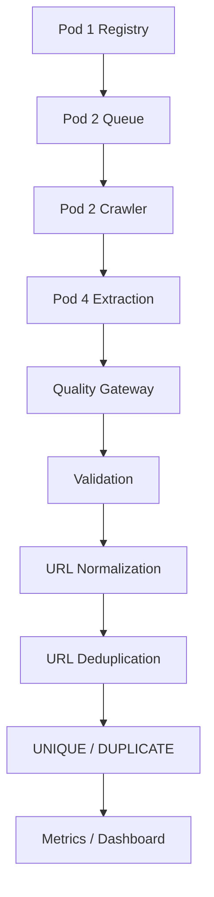

# Quality Gateway

## Project

Quality Gateway

## Context

- Darktrace Project
- Module 2
- Pod 3
- Week 3 Core Pipeline

## Week 3 objective

The Week 3 objective is to implement a production-style Quality Gateway that receives structured records from multiple upstream sources, validates and normalizes them, and performs URL-level deduplication before pushing results onward for downstream validation, metrics, and dashboard reporting.

## Architecture

The service is separated into frontend, backend, dummy data, integration simulation, and testing layers. The backend remains modular and is independent from the UI and test assets.

## Multi-source pipeline

Pod 1 Registry → Pod 2 Queue → Pod 2 Crawler → Pod 4 Extraction → Quality Gateway → Validation → URL Normalization → URL Deduplication → UNIQUE / DUPLICATE → Metrics / Dashboard



## URL normalization

Incoming URLs are normalized before duplicate comparison. The system:

- lowercases scheme and hostname
- removes default ports and trailing host dots
- punycodes IDN hostnames and preserves bracketed IPv6 hosts
- strips fragments
- trims whitespace
- normalizes trailing slashes
- sorts query parameters and removes empty queries
- decodes unreserved percent escapes and uppercases other escape hex
- strips common tracking parameters by default (`deduplication.strip_tracking_params`)
- preserves canonical path semantics

## URL-level deduplication

Week 3 implements URL-level deduplication only. A duplicate is determined by a normalized URL match. The system does not implement content hashing, semantic deduplication, SimHash, MinHash, or similar methods in this phase.

## Database model

The default SQLite database uses tables for:

- records
- url_index
- duplicate_events
- rejected_records

These tables support canonical record tracking, first-seen / last-seen metrics, and duplicate relationship storage.
Invalid submissions are retained in `rejected_records`; they never create a `url_index` entry.
Every processed item is also appended to `data/submitted_records.jsonl`. Configure the filename with
`storage.submissions_file` in `config/settings.yaml`, or set `QUALITY_GATEWAY_DATA_DIR` to relocate the
data directory. Audit-write failures add a warning to the response without failing processing. The
`dummy_data/` fixtures are never written or modified by the service.

## API contract

The backend exposes:

- /health
- /api/v1/records/process
- /api/v1/records/process/batch
- /api/v1/records (limit, offset, source_id, dedup_status, validation_status)
- /api/v1/records/{record_id}
- /api/v1/records/export?format=json|jsonl
- /api/v1/dedup/check
- /api/v1/dedup/duplicates
- /api/v1/metrics
- /docs
- /openapi.json

## UI

The user interface is kept separate in the ui folder and queries the backend APIs for dashboard data. It uses an HTML/CSS/JavaScript architecture without a frontend framework.
Uploads accept JSON arrays, `{"records": [...]}`, single record objects, and JSONL objects. The UI previews
the first three records and submits batches in chunks of 500 when Process Record is clicked.

## Metrics definitions

- `duplicate_rate_percent` = duplicate records / valid records × 100
- `unique_rate_percent` = unique records / valid records × 100
- `rejection_rate` = invalid records / total received (fraction from 0 to 1)
- `total_received` = stored records + rejected records

The batch summary and `/api/v1/metrics` use identical duplicate and unique rate denominators.

## Dummy data

Synthetic records and source definitions are kept in the dummy_data directory to support testing and demo flows without contaminating production code.

## Testing

The project includes pytest coverage across validation, normalization, deduplication, database persistence, batch processing, API testing, and integration simulation.

## Integration demo

The integration_demo folder simulates the controlled behavior of Pod 1, Pod 2, and Pod 4 before passing records into the real Quality Gateway backend.

## Running locally

On Windows, start the backend and UI together and open the UI in your browser:

```powershell
.\scripts\run_all.ps1
```

The launcher reuses a healthy service already running on the configured port (default 8001).
The API docs are available at http://127.0.0.1:8001/docs and the UI at
http://127.0.0.1:5173/.

For manual startup:

```bash
pip install -r backend/requirements.txt
uvicorn backend.main:app --reload --host 127.0.0.1 --port 8001
```

Then open:

- http://127.0.0.1:8001/docs
- ui/index.html

`scripts/run_backend.sh` starts the same `uvicorn backend.main:app` entry point from the repository root.
Set `QUALITY_GATEWAY_API_PORT` to select another backend port. The frontend API can be overridden with
the `?api=http://host:port` query parameter.

## Limitations

This effort implements URL-level deduplication only. It does not currently perform:

- content-hash deduplication
- SimHash deduplication
- MinHash deduplication
- semantic duplicate detection

Those capabilities are future Week 4+ enhancements.

## Future improvements

- per-source deduplication policy
- content similarity scoring
- risk-scoring and enrichment
- scheduler and queue integration
- production database backend

## Duplicate hotspot dashboard

The dashboard's Duplicate Hotspots panel ranks up to five normalized URLs by duplicate record count. It reads the existing `top_duplicate_urls` field from `/api/v1/metrics` and helps operators spot URLs that recur across sources. The ranking counts duplicate records per normalized URL; it does not indicate maliciousness or content similarity.
